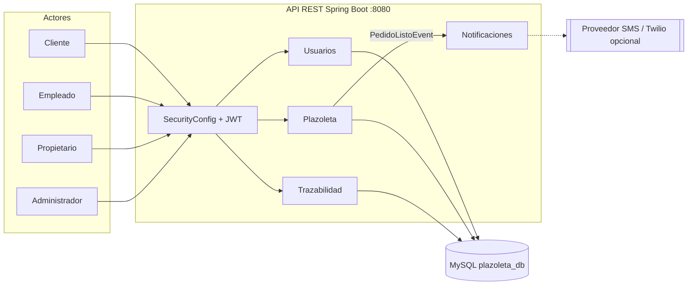

# Plazoleta — Documentación general

API REST para la administración de una plazoleta de comida. El sistema cubre el
ciclo completo del negocio: registro de usuarios y roles, creación de
restaurantes y menús, consulta de catálogo por parte del cliente, creación y
gestión de pedidos, entrega con PIN, cancelación, notificaciones y trazabilidad
de estados.

> Este README documenta **todo el proyecto** (HU-01 a HU-17), no solo el Sprint 3.
> El Sprint 3 aportó el ciclo de vida del pedido y la trazabilidad; los módulos
> de usuarios, restaurantes, platos y consultas se construyeron en las entregas
> anteriores y siguen vigentes.

## 1. Estado del proyecto

| Elemento | Estado |
|---|---|
| Historias implementadas | HU-01 a HU-17 |
| Historias fuera de alcance | HU-18 |
| Pruebas automatizadas | 50 (0 fallos) |
| Verificación funcional contra MySQL | 22/22 casos |
| Documentación OpenAPI | Disponible en `/v3/api-docs` y Swagger UI |
| Ramas principales | `main`, `develop` |
| Tags publicados | `v3.0.0`, `v3.0.1` |
| Despliegue | Un único servicio Spring Boot (monolito modular) |

## 2. Alcance funcional

### 2.1. Historias de usuario

| HU | Funcionalidad | Rol principal | Estado |
|---|---|---|---|
| HU-01 | Registrar propietario de restaurante | ADMINISTRADOR | Implementada |
| HU-02 | Registrar restaurante | ADMINISTRADOR | Implementada |
| HU-03 | Crear plato | PROPIETARIO dueño | Implementada |
| HU-04 | Modificar plato | PROPIETARIO dueño | Implementada |
| HU-05 | Iniciar sesión y emitir token JWT | Público | Implementada |
| HU-06 | Registrar empleado | PROPIETARIO dueño | Implementada |
| HU-07 | Habilitar o deshabilitar plato | PROPIETARIO dueño | Implementada |
| HU-08 | Registrar cliente | Público | Implementada |
| HU-09 | Listar restaurantes | CLIENTE | Implementada |
| HU-10 | Listar platos de un restaurante por categoría | CLIENTE | Implementada |
| HU-11 | Realizar pedido | CLIENTE | Implementada |
| HU-12 | Listar pedidos por estado | EMPLEADO | Implementada |
| HU-13 | Asignarse a un pedido y pasarlo a preparación | EMPLEADO | Implementada |
| HU-14 | Notificar pedido listo y generar PIN | EMPLEADO | Implementada |
| HU-15 | Entregar pedido validando PIN | EMPLEADO | Implementada |
| HU-16 | Cancelar pedido pendiente | CLIENTE dueño | Implementada |
| HU-17 | Consultar trazabilidad del pedido | CLIENTE dueño | Implementada |
| HU-18 | Fuera de alcance de la entrega | — | No implementada |

### 2.2. Bloques de entrega

| Bloque | Historias | Resultado |
|---|---|---|
| Base de usuarios y catálogo | HU-01 a HU-08 | Registro de propietarios, empleados y clientes; autenticación JWT; restaurantes, categorías y platos. |
| Consulta y pedidos | HU-09 a HU-12 | Catálogo visible para el cliente; creación de pedidos y listado por estado para el empleado. |
| Ciclo de vida y trazabilidad | HU-13 a HU-17 | Asignación, notificación con PIN, entrega, cancelación e historial de estados. |

## 3. Roles y permisos

| Rol | Puede hacer | Alcance |
|---|---|---|
| **ADMINISTRADOR** | Crear propietarios, restaurantes y categorías. | Global. |
| **PROPIETARIO** | Crear y modificar platos, habilitarlos/deshabilitarlos y registrar empleados. | Solo su propio restaurante. |
| **EMPLEADO** | Listar pedidos por estado, asignarse pedidos, marcarlos listos y entregarlos con PIN. | Solo pedidos de su restaurante. |
| **CLIENTE** | Listar restaurantes y platos, crear pedidos, consultar su PIN, cancelar pedidos pendientes y ver su trazabilidad. | Solo sus propios pedidos. |
| **Público** | Iniciar sesión y registrar una cuenta de cliente. | Sin token. |

El detalle de reglas por endpoint está en la sección [8. API REST](#8-api-rest).

## 4. Arquitectura

El proyecto se entrega como **un único despliegue Spring Boot** organizado en
cuatro contextos delimitados. La separación física en microservicios está
documentada como ruta de migración, no implementada todavía.

| Contexto | Responsabilidad | Historias |
|---|---|---|
| Usuarios | Registro, autenticación, roles y permisos | HU-01, HU-05, HU-06, HU-08 |
| Plazoleta | Restaurantes, categorías, platos y pedidos | HU-02, HU-03, HU-04, HU-07, HU-09, HU-10, HU-11, HU-12 |
| Trazabilidad | Registro y consulta del historial de estados | HU-13, HU-16, HU-17 |
| Notificaciones | Aviso al cliente y PIN de seguridad | HU-14, HU-15 |



Flujo resumido:

1. `Usuarios` valida credenciales y emite un JWT con el rol.
2. `Plazoleta` gestiona restaurantes, platos y el ciclo del pedido.
3. `Trazabilidad` registra cada transición en `pedido_estado_log`.
4. `Notificaciones` recibe `PedidoListoEvent` después del commit y envía el PIN
   al cliente (en desarrollo se escribe en el log).

Diagramas de arquitectura, clases, entidades y secuencias:
[`docs/ARQUITECTURA.md`](docs/ARQUITECTURA.md).

## 5. Modelo de datos

Base de datos: `plazoleta_db` (MySQL 8). Siete tablas:

| Tabla | Propósito | Relaciones principales |
|---|---|---|
| `usuario` | Usuarios y roles del sistema. | `id_restaurante` → `restaurante` (empleados). |
| `restaurante` | Restaurantes de la plazoleta. | `id_propietario` → `usuario`. |
| `categoria` | Categorías del menú. | — |
| `plato` | Platos ofrecidos por cada restaurante. | `id_categoria`, `id_restaurante`. |
| `pedido` | Cabecera del pedido y estado actual. | `id_cliente`, `id_restaurante`, `id_empleado`. |
| `detalle_pedido` | Platos y cantidades de cada pedido. | `id_pedido`, `id_plato`. |
| `pedido_estado_log` | Historial de cambios de estado. | `id_pedido`, `id_empleado`. |

Detalles relevantes:

- `pedido.version` implementa **bloqueo optimista** (`@Version`) para evitar
  transiciones concurrentes inconsistentes.
- `pedido_estado_log` guarda estado anterior, estado nuevo, empleado y fecha.
- Hay índices para las consultas por cliente/estado, restaurante/estado y menú.
- El PIN se almacena en `pedido.pin` y nunca se expone al empleado.

Diccionario completo:
[`docs/DiccionarioDatos.md`](docs/DiccionarioDatos.md).

## 6. Reglas de negocio

### Usuarios

- Correo y documento de identidad son únicos.
- La clave se guarda con BCrypt.
- El propietario, el empleado y el cliente deben ser mayores de 18 años.
- El documento es numérico; el celular admite `+` y máximo 13 caracteres.
- Un empleado queda asociado al restaurante indicado por el propietario.

### Restaurantes, categorías y platos

- El NIT es único y tiene formato de 9 o 10 dígitos, con dígito de verificación
  opcional separado por guion (`900000000-1`).
- Solo el administrador crea restaurantes y categorías.
- Solo el propietario dueño del restaurante puede crear, modificar o cambiar el
  estado de sus platos.
- Un plato nuevo nace activo; el cliente solo ve platos activos.
- El precio debe ser entero y mayor que cero.

### Pedidos

- El pedido debe tener al menos un plato; las cantidades deben ser mayores que
  cero y no se permiten platos repetidos.
- Todos los platos deben existir, estar activos y pertenecer al mismo
  restaurante.
- Un cliente solo puede tener **un pedido en proceso** (`PENDIENTE`,
  `EN_PREPARACION` o `LISTO`).
- El total se calcula con el precio vigente de cada plato.
- El cliente solo opera sus propios pedidos; el empleado solo los de su
  restaurante.
- El pedido nace en `PENDIENTE` y cada transición queda registrada.

### Entrega y PIN

- Al marcar un pedido como `LISTO`, se genera un PIN de 4 dígitos y se envía al
  cliente (simulado en el log).
- El PIN se devuelve únicamente al cliente dueño mediante
  `GET /api/v1/pedidos/{id}/pin`.
- La respuesta al empleado en `PATCH /listo` **no incluye** el PIN.
- La entrega exige el PIN correcto y solo aplica a pedidos `LISTO`.

### Cancelación

- Solo el cliente dueño puede cancelar.
- Solo se puede cancelar un pedido en estado `PENDIENTE`.
- Un pedido en preparación, listo o entregado no se puede cancelar.

## 7. Seguridad

- Autenticación **stateless** con JWT (filtro propio + Spring Security).
- Contraseñas con **BCrypt**.
- Token enviado como `Authorization: Bearer <token>`.
- Expiración configurable con `JWT_EXPIRATION` (1 hora por defecto).
- Reglas por rol y por método HTTP en `SecurityConfig`.
- Verificación de propiedad del recurso en la capa de servicio:
  - propietario → su restaurante;
  - empleado → su restaurante;
  - cliente → sus pedidos.
- Respuestas coherentes: **401** sin token o token inválido, **403** con token
  pero sin permiso.
- El PIN nunca se incluye en respuestas al empleado.

## 8. API REST

### Convenciones

- Base URL local: `http://localhost:8080`
- Formato: JSON.
- Autenticación: `Authorization: Bearer <token>`.
- Paginación: `pagina` (desde 0) y `tamano` (máximo 50).
- Errores: cuerpo JSON `{"mensaje": "..."}` o mapa de campos inválidos.

### 8.1. Autenticación

| Método | Ruta | Rol | HU |
|---|---|---|---|
| POST | `/api/v1/auth/login` | Público | HU-05 |

### 8.2. Usuarios

| Método | Ruta | Rol | HU |
|---|---|---|---|
| POST | `/api/v1/usuarios/registro-propietario` | ADMINISTRADOR | HU-01 |
| POST | `/api/v1/usuarios/empleado` | PROPIETARIO | HU-06 |
| POST | `/api/v1/usuarios/cliente` | Público | HU-08 |

### 8.3. Restaurantes y categorías

| Método | Ruta | Rol | HU |
|---|---|---|---|
| POST | `/api/v1/restaurantes` | ADMINISTRADOR | HU-02 |
| GET | `/api/v1/restaurantes?pagina=0&tamano=10` | CLIENTE | HU-09 |
| POST | `/api/v1/categorias/registro` | ADMINISTRADOR | — |
| GET | `/api/v1/categorias` | Autenticado | — |

### 8.4. Platos

| Método | Ruta | Rol | HU |
|---|---|---|---|
| POST | `/api/v1/platos/registro` | PROPIETARIO dueño | HU-03 |
| PATCH | `/api/v1/platos/{idPlato}` | PROPIETARIO dueño | HU-04 |
| PATCH | `/api/v1/platos/{idPlato}/estado` | PROPIETARIO dueño | HU-07 |
| GET | `/api/v1/platos?idRestaurante=1&idCategoria=1&pagina=0&tamano=10` | CLIENTE | HU-10 |

### 8.5. Pedidos

| Método | Ruta | Rol | HU |
|---|---|---|---|
| POST | `/api/v1/pedidos` | CLIENTE | HU-11 |
| GET | `/api/v1/pedidos?estado=PENDIENTE&pagina=0&tamano=10` | EMPLEADO | HU-12 |
| PATCH | `/api/v1/pedidos/{id}/asignar` | EMPLEADO | HU-13 |
| PATCH | `/api/v1/pedidos/{id}/listo` | EMPLEADO | HU-14 |
| GET | `/api/v1/pedidos/{id}/pin` | CLIENTE dueño | HU-14 / HU-15 |
| PATCH | `/api/v1/pedidos/{id}/entregar` | EMPLEADO | HU-15 |
| PATCH | `/api/v1/pedidos/{id}/cancelar` | CLIENTE dueño | HU-16 |
| GET | `/api/v1/pedidos/{id}/trazabilidad` | CLIENTE dueño | HU-17 |

### 8.6. Flujo de estados

```text
PENDIENTE ──asignar (EMPLEADO)──> EN_PREPARACION ──listo (EMPLEADO)──> LISTO
    │                                                                   │
    │ cancelar (CLIENTE)                                    entregar (PIN)
    ▼                                                                   ▼
CANCELADO                                                           ENTREGADO
```

Cada transición se registra en `pedido_estado_log` para la trazabilidad
(HU-17). Un pedido `ENTREGADO` o `CANCELADO` es un estado final.

### 8.7. Ejemplo rápido

```powershell
# 1. Login
$login = Invoke-RestMethod -Method POST http://localhost:8080/api/v1/auth/login `
  -ContentType "application/json" `
  -Body '{"correo":"cliente@plazoleta.com","clave":"Admin123*"}'

# 2. Crear pedido
$headers = @{ Authorization = "Bearer $($login.token)" }
Invoke-RestMethod -Method POST http://localhost:8080/api/v1/pedidos `
  -Headers $headers -ContentType "application/json" `
  -Body '{"idRestaurante":1,"platos":[{"idPlato":1,"cantidad":2}]}'
```

## 9. Manejo de errores

Todas las excepciones pasan por `GlobalExceptionHandler`, que evita exponer
stack traces y mantiene un contrato uniforme.

| Código | Significado | Ejemplos |
|---|---|---|
| 400 | Validación o regla de negocio | Correo duplicado, documento duplicado, plato inactivo, estado inválido, PIN incorrecto. |
| 401 | No autenticado | Sin token, token inválido o expirado, credenciales incorrectas. |
| 403 | Autenticado sin permiso | Cliente intentando asignar un pedido, propietario ajeno, empleado de otro restaurante. |
| 404 | Recurso inexistente | Pedido, plato o ruta no encontrada. |
| 409 | Conflicto | Violación de unicidad o bloqueo optimista sobre el mismo pedido. |
| 500 | Error no controlado | Se registra en el log y se responde con un mensaje genérico. |

## 10. Patrones de diseño

| Patrón | Implementación | Para qué |
|---|---|---|
| **Singleton** | Beans de Spring (`@Service`, `@Repository`, `@RestController`). | Una instancia gestionada por el contenedor. |
| **Builder** | Lombok `@Builder` en entidades y DTOs. | Construcción legible de objetos. |
| **Repository** | Interfaces Spring Data JPA. | Abstrae el acceso a datos y las consultas derivadas. |
| **Strategy** | `SmsService` + `SmsServiceImpl`. | Cambiar el proveedor de SMS sin tocar el dominio. |
| **Observer / Event** | `PedidoListoEvent` + `PedidoListoNotificacionListener` (`AFTER_COMMIT`). | Desacoplar la notificación del caso de uso. |
| **DTO / Mapper** | Paquete `dto` y métodos de conversión. | Controlar el contrato de la API y no exponer entidades. |
| **Dependency Injection** | Constructor generado por `@RequiredArgsConstructor`. | Facilitar pruebas con Mockito. |

## 11. Pruebas y calidad

```powershell
.\mvnw.cmd test
```

- **50 pruebas automatizadas**: unitarias de servicios y carga de contexto.
- Perfil H2 (`src/test/resources/application-test.properties`): no requieren
  MySQL para ejecutarse.
- `UsuarioServiceImplTest`: 10 casos de registro (propietario, empleado y
  cliente), duplicados, edad y validaciones.
- `PedidoServiceImplTest`: flujo de pedido, PIN, entrega, cancelación y
  transiciones.
- `TrazabilidadServiceImplTest`: consulta del historial y control de acceso.
- Verificación funcional manual contra MySQL: **22/22 casos** (login, pedidos,
  PIN, entrega, cancelación, trazabilidad y seguridad).
- No se reporta porcentaje de cobertura porque no se ejecutó JaCoCo.

## 12. Postman

La colección canónica cubre las HU y los casos de seguridad:

```text
postman/collections/Plazoleta - HU Autenticacion.postman_collection.json
```

Ejecutar las carpetas en este orden:

```text
0 → A → B → D → C → E → F → G → H → I → J → K → L → M → N → O
```

- **0** prepara usuarios y tokens.
- **M** incluye `M0 GET PIN del pedido (CLIENTE)` antes de los casos de entrega.
- Las variables se completan automáticamente entre carpetas.

Con Newman, si está instalado:

```powershell
npx newman run "postman/collections/Plazoleta - HU Autenticacion.postman_collection.json" --env-var baseUrl=http://localhost:8080
```

Guía detallada: [`postman/README.md`](postman/README.md).

## 13. Puesta en marcha

### Requisitos

- Java 24 o superior.
- MySQL 8 en ejecución.
- No hace falta Maven: el proyecto incluye `mvnw.cmd` (Windows) y `mvnw`
  (Linux/macOS).

### 13.1. Crear la base de datos

Para una base nueva:

```powershell
mysql -u root -p < docs/script.sql
```

El script crea `plazoleta_db`, las siete tablas, los índices y los datos
semilla. No elimina la base completa.

Si ya existe una base de una entrega anterior:

```powershell
mysql -u root -p plazoleta_db < docs/migration-sprint3.sql
```

> Es obligatorio aplicar la migración antes de arrancar: `ddl-auto=validate`
> espera la columna `pedido.version`.

### 13.2. Variables de entorno

Copia `.env.example` y define tus valores, o expórtalos en la terminal:

```powershell
$env:DB_URL="jdbc:mysql://localhost:3306/plazoleta_db?serverTimezone=America/Bogota&allowPublicKeyRetrieval=true&useSSL=false"
$env:DB_USERNAME="root"
$env:DB_PASSWORD="tu_clave"
$env:JWT_SECRET="una-clave-propia-de-al-menos-32-caracteres"
```

| Variable | Obligatoria en producción | Valor por defecto (desarrollo) |
|---|---|---|
| `DB_URL` | Sí | `jdbc:mysql://localhost:3306/plazoleta_db?...` |
| `DB_USERNAME` | Sí | `root` |
| `DB_PASSWORD` | Sí | `root` |
| `JWT_SECRET` | Sí | Clave de desarrollo (no usar en producción) |
| `JWT_EXPIRATION` | No | `3600000` ms (1 hora) |
| `JPA_SHOW_SQL` | No | `false` |
| `SECURITY_LOG_LEVEL` | No | `INFO` |

### 13.3. Ejecutar

```powershell
.\mvnw.cmd spring-boot:run
```

La aplicación queda en `http://localhost:8080`.

### 13.4. Swagger

- Swagger UI: `http://localhost:8080/swagger-ui.html`
- OpenAPI JSON: `http://localhost:8080/v3/api-docs`

Usa **Authorize** con el token obtenido en `POST /api/v1/auth/login`.

### 13.5. Usuarios semilla

| Rol | Correo | Clave |
|---|---|---|
| ADMINISTRADOR | `admin@plazoleta.com` | `Admin123*` |
| CLIENTE | `cliente@plazoleta.com` | `Admin123*` |
| EMPLEADO | `empleado@plazoleta.com` | `Admin123*` |
| PROPIETARIO | `propietario@plazoleta.com` | `Admin123*` |

El empleado y el propietario están asociados al restaurante demo
`900000000-1`. Cambia estas claves antes de cualquier despliegue real.

## 14. Estructura del proyecto

```text
src/main/java/com/plazoletaucc/Plazoleta/
├── config/          OpenAPI
├── controller/      Endpoints REST
├── dto/             Request y response
├── entity/          Entidades JPA
├── event/           Evento y listener de notificación
├── exception/       Excepciones y GlobalExceptionHandler
├── repository/      Repositorios Spring Data
├── security/        JWT, filtro y reglas por rol
└── service/         Interfaces e implementaciones

src/test/            Pruebas JUnit 5 + Mockito + H2
docs/                Arquitectura, datos, Git Flow y Scrum
postman/             Colección por HU
```

## 15. Documentación

| Documento | Contenido |
|---|---|
| [`docs/ARQUITECTURA.md`](docs/ARQUITECTURA.md) | Contextos, patrones, diagramas Mermaid y ruta a microservicios. |
| [`docs/DiccionarioDatos.md`](docs/DiccionarioDatos.md) | Tablas, columnas, restricciones e índices. |
| [`docs/GITFLOW.md`](docs/GITFLOW.md) | Ramas, convención de commits y procedimiento de cierre. |
| [`docs/scrum/KANBAN.md`](docs/scrum/KANBAN.md) | Tablero y Definición de Terminado. |
| [`docs/scrum/SPRINT-3-PLANNING.md`](docs/scrum/SPRINT-3-PLANNING.md) | Alcance, criterios y riesgos del Sprint 3. |
| [`docs/scrum/SPRINT-3-REVIEW.md`](docs/scrum/SPRINT-3-REVIEW.md) | Incremento y guion de demo. |
| [`docs/scrum/RETROSPECTIVA.md`](docs/scrum/RETROSPECTIVA.md) | Lecciones y acciones de mejora. |
| [`docs/scrum/PARTICIPACION.md`](docs/scrum/PARTICIPACION.md) | Métricas reales de Git. |
| [`postman/README.md`](postman/README.md) | Orden de ejecución de la colección. |

## 16. Git Flow y releases

- Ramas: `main` (producción), `develop` (integración), `feature/HU-*` y
  `fix/*`.
- Formato de commit: `tipo(modulo): descripcion corta [HU-xx]`.
- Integración de cierre: merge local `--no-ff` de `develop` hacia `main`
  (no se usó GitHub CLI porque no está instalado).
- Tags publicados:
  - `v3.0.0`: cierre del Sprint 3 (HU-13 a HU-17).
  - `v3.0.1`: corrección de transacciones en platos.
- `develop` y `main` están sincronizados con `origin`.
- Historial, PR y métricas reales: [`docs/GITFLOW.md`](docs/GITFLOW.md).

## 17. Limitaciones y roadmap

1. **Microservicios**: el sistema es un monolito modular. La ruta de separación
   en cuatro servicios está documentada en `docs/ARQUITECTURA.md`, sección 7.
2. **SMS real**: `SmsServiceImpl` escribe el mensaje en el log. La interfaz
   `SmsService` permite conectar Twilio u otro proveedor sin cambiar el dominio.
3. **HU-18**: no implementada; quedó fuera del alcance de la entrega.
4. **Cobertura**: no se mide con JaCoCo; no se reporta un porcentaje inventado.
5. **Integración continua**: las pruebas se ejecutan manualmente.
6. **Historial Git**: la frecuencia de commits por semana y por integrante no se
   cumple en todas las semanas; no se reescribió el historial para simularla.

## 18. Equipo y entrega

- Evaluación: **lunes 9 de noviembre de 2026**, 6:10 a. m. (asistencia y
  evaluación individual); sustentaciones desde las 7:00 a. m., máximo 20
  minutos.
- Integrantes identificados en Git: `ardilamelina8-blip` y Simon
  (`simon-svg294`).
- Repositorio: `develop` y `main` integrados el 2026-11-06; tags `v3.0.0` y
  `v3.0.1`.
