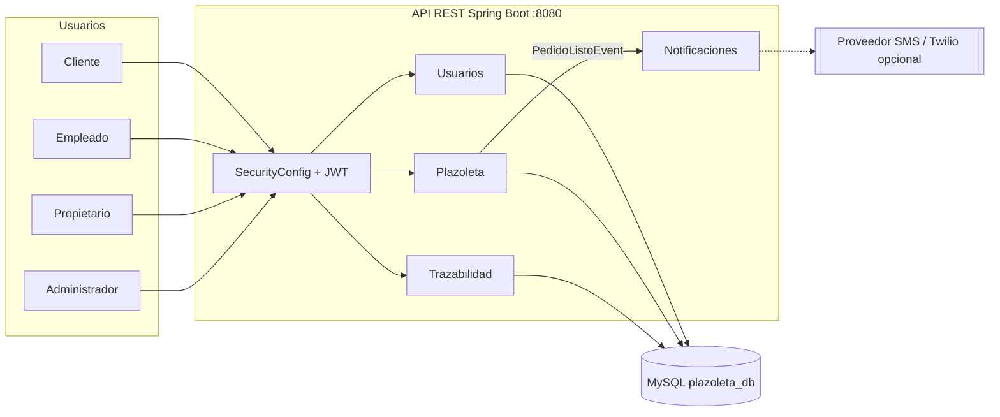
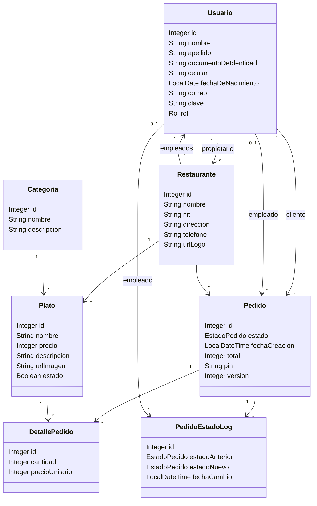
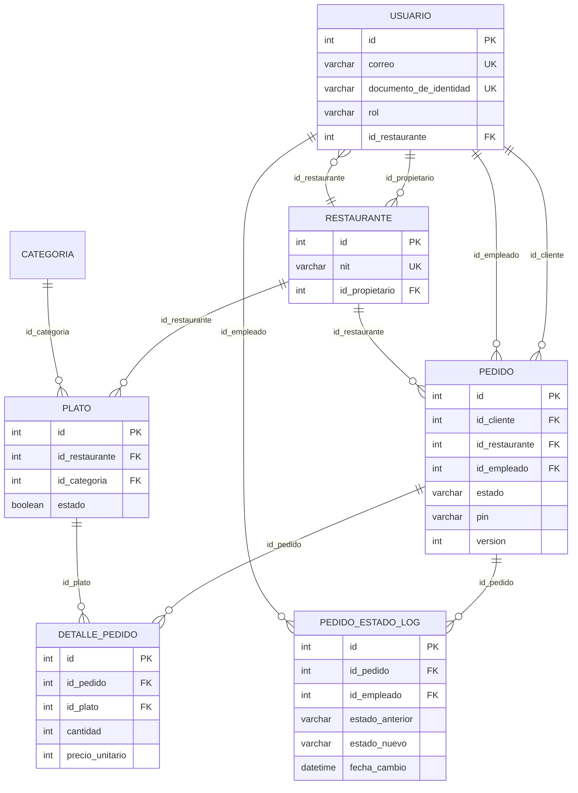
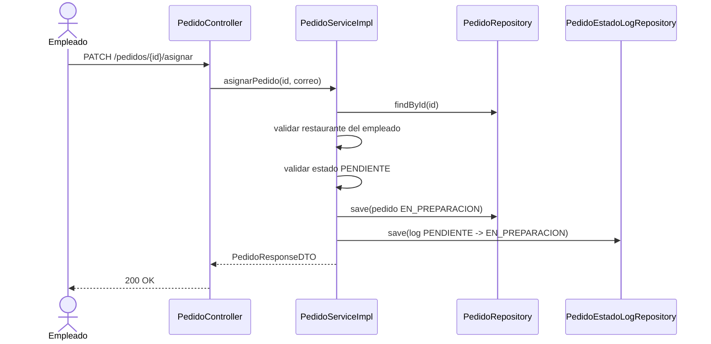
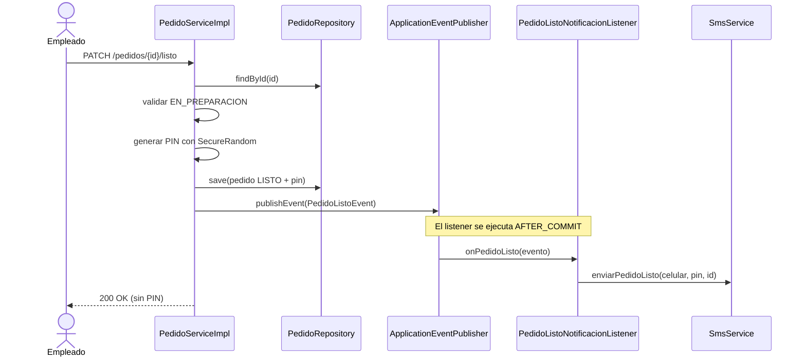
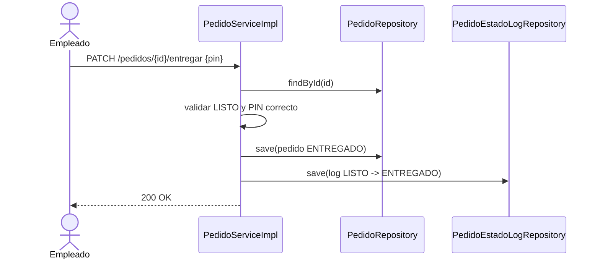
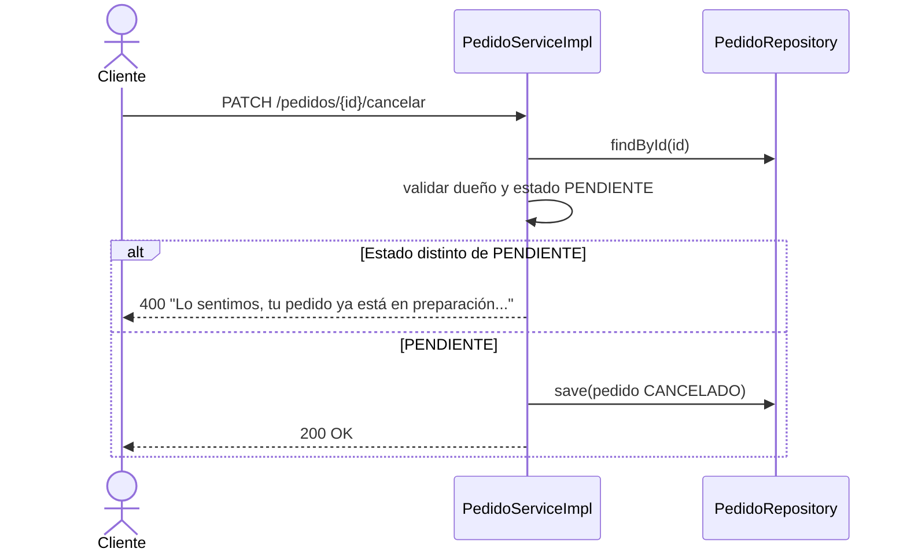
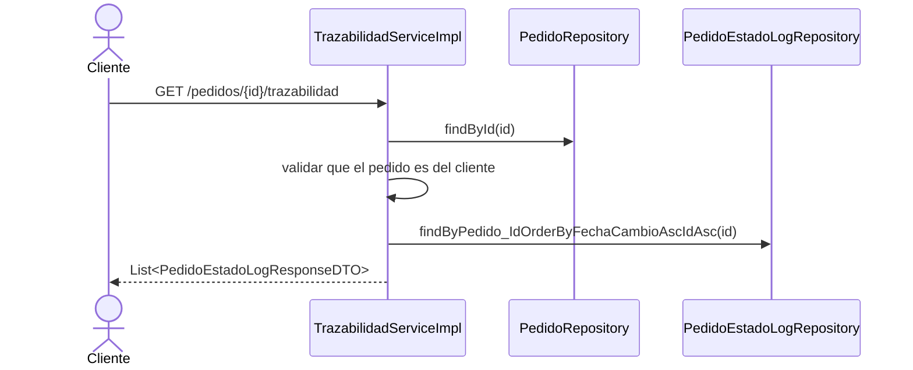

# Arquitectura y diseño — Plazoleta

> Documento de apoyo para la sustentación del Sprint 3. Describe la arquitectura
> implementada, los patrones de diseño, el modelo de datos y la ruta de migración
> hacia microservicios.

## 1. Estado actual

El proyecto se entrega como **un único despliegue Spring Boot** organizado por
contextos delimitados (bounded contexts) que coinciden con los microservicios
propuestos en el enunciado:

| Contexto | Paquete principal | Responsabilidad | Historias |
|---|---|---|---|
| Usuarios | `controller`, `service`, `security` | Registro, autenticación, roles y permisos | HU-01, HU-05, HU-06, HU-08 |
| Plazoleta | `controller`, `service`, `entity` | Restaurantes, categorías, platos y pedidos | HU-02, HU-03, HU-04, HU-07, HU-09, HU-10, HU-11, HU-12 |
| Trazabilidad | `service.impl.TrazabilidadServiceImpl`, `entity.PedidoEstadoLog` | Historial de estados y consulta del cliente | HU-13, HU-16, HU-17 |
| Notificaciones | `service.SmsService`, `event.PedidoListoNotificacionListener` | Aviso al cliente y PIN de seguridad | HU-14, HU-15 |

**Decisión consciente:** se priorizó un monolito modular funcional y verificable
para la demo, con los contextos separados por paquetes y contratos de servicio.
La separación física en cuatro procesos es la siguiente fase de la ruta de
migración (sección 7), no un cambio que se pueda completar sin arriesgar la
entrega del lunes.

## 2. Diagrama de arquitectura

Flujo resumido:

1. `Usuarios` valida credenciales y emite el JWT con el rol.
2. `Plazoleta` gestiona restaurantes, platos y el ciclo del pedido.
3. `Trazabilidad` registra cada transición en `pedido_estado_log`.
4. `Notificaciones` recibe el evento `PedidoListoEvent` después del commit y
   envía el PIN al cliente (en desarrollo se escribe en el log).

## 3. Patrones de diseño aplicados

| Patrón | Dónde | Para qué |
|---|---|---|
| **Singleton** | Beans de Spring (`@Service`, `@Repository`, `@RestController`) | Una sola instancia por contenedor; el contenedor gestiona el ciclo de vida. |
| **Builder** | Entidades y DTOs con Lombok `@Builder` | Construcción legible de objetos con muchos campos. |
| **Repository** | `UsuarioRepository`, `PedidoRepository`, etc. | Abstrae el acceso a datos y las consultas derivadas. |
| **Strategy** | `SmsService` + `SmsServiceImpl` | Permite cambiar la implementación de SMS (log, Twilio, otro proveedor) sin tocar el dominio. |
| **Observer / Event** | `PedidoListoEvent` + `PedidoListoNotificacionListener` | Desacopla la notificación del caso de uso y la ejecuta después del commit. |
| **DTO / Mapper** | Paquete `dto` y métodos `convertir` | Evita exponer entidades y controla el contrato de la API. |
| **Dependency Injection** | Constructor generado por `@RequiredArgsConstructor` | Facilita pruebas unitarias con Mockito. |

## 4. Modelo de clases

## 5. Modelo relacional

## 6. Secuencias del ciclo del pedido

### HU-13 — Asignarse y pasar a EN_PREPARACION

### HU-14 — Pedido listo y PIN

### HU-15 — Entregar con PIN

### HU-16 — Cancelar pedido

### HU-17 — Trazabilidad

## 7. Ruta de migración a microservicios

La separación física recomendada, en orden de riesgo:

1. **Notificaciones** (bajo riesgo): mover `SmsService` a un proceso aparte y
   consumir `POST /api/v1/notificaciones/sms`. Es el contexto con menos
   dependencias de datos.
2. **Trazabilidad** (riesgo medio): separar `pedido_estado_log` y publicar los
   cambios de estado mediante eventos (RabbitMQ/Kafka) o REST.
3. **Usuarios** (riesgo medio-alto): separar autenticación y emisión de JWT;
   Plazoleta valida el token con la clave pública o consulta a Usuarios.
4. **Plazoleta** (riesgo alto): conservar el núcleo de restaurantes, platos y
   pedidos; extraer las consultas de solo lectura si se requiere escalar.

Componentes transversales necesarios: API Gateway, configuración centralizada,
descubrimiento de servicios, trazabilidad distribuida y contratos OpenAPI por
servicio.

## 8. Decisiones no funcionales

| Tema | Decisión |
|---|---|
| Seguridad | JWT stateless, BCrypt, autorización por rol y por recurso (dueño del pedido/restaurante). |
| Concurrencia | Bloqueo optimista (`@Version`) en `Pedido`; bloqueo pesimista del cliente al crear pedido. |
| Rendimiento | Paginación con tope de 50, `@EntityGraph` para relaciones to-one e índices en `pedido` y `plato`. |
| Errores | `GlobalExceptionHandler` con respuestas `{"mensaje": ...}` y códigos 400/401/403/404/409/500. |
| Notificaciones | Evento después del commit; un fallo del SMS no revierte el pedido. |
| Pruebas | 50 pruebas (unitarias + contexto) con H2, sin depender de MySQL. |
| Documentación | OpenAPI/Swagger, Postman por HU y diagramas Mermaid versionados. |
