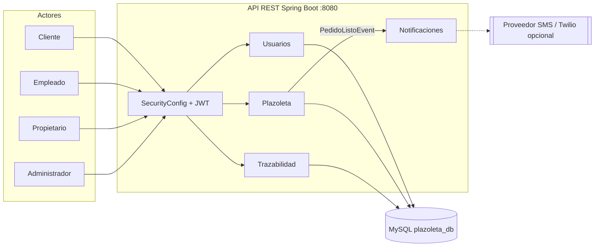
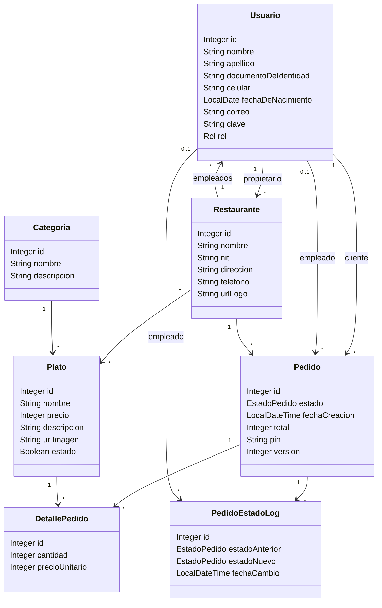
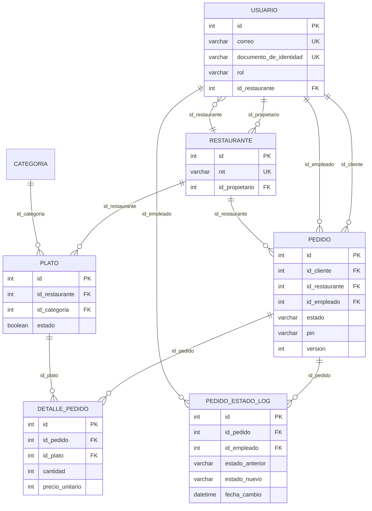
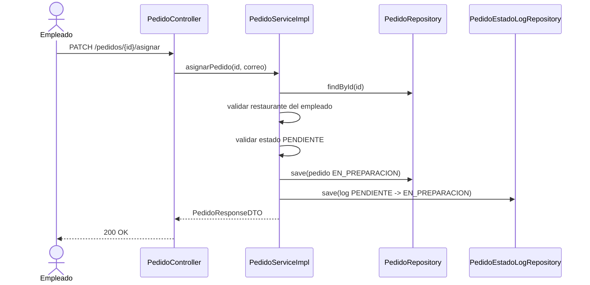
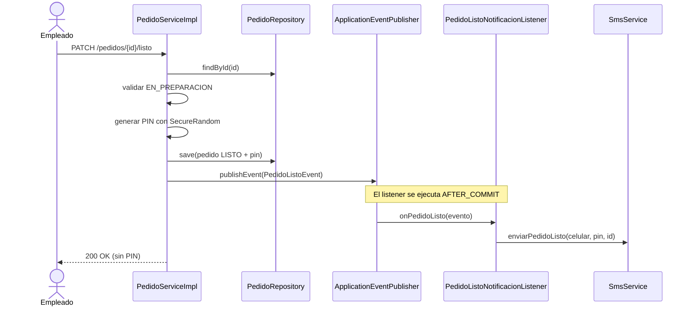
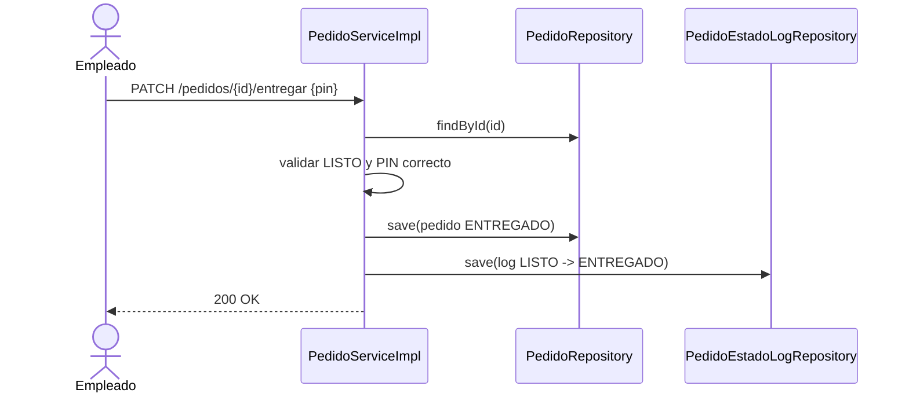
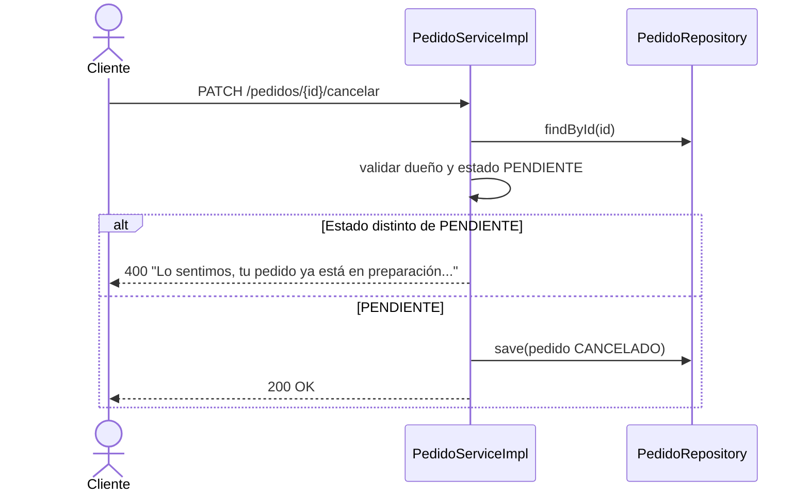
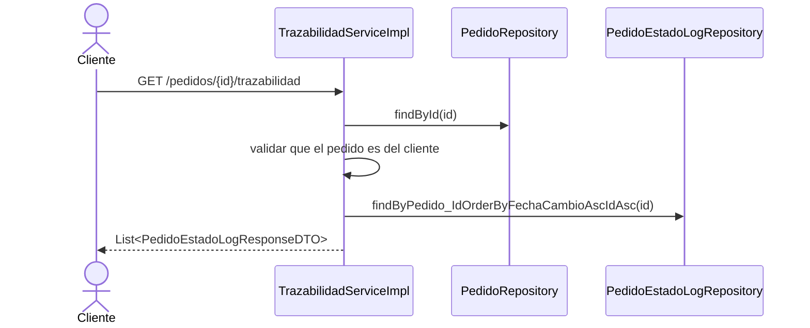

# Plazoleta — Documentación consolidada

> Documento único del proyecto. Reúne alcance, arquitectura, modelo de datos,
> API, operación, Git Flow y evidencias Scrum. La base de datos completa está en
> [`script.sql`](script.sql).

## Índice

1. [Resumen ejecutivo](#1-resumen-ejecutivo)
2. [Alcance funcional](#2-alcance-funcional)
3. [Roles y permisos](#3-roles-y-permisos)
4. [Arquitectura](#4-arquitectura)
5. [Patrones de diseño](#5-patrones-de-diseño)
6. [Modelo de datos](#6-modelo-de-datos)
7. [Reglas de negocio](#7-reglas-de-negocio)
8. [Seguridad](#8-seguridad)
9. [API REST](#9-api-rest)
10. [Flujo de estados](#10-flujo-de-estados)
11. [Manejo de errores](#11-manejo-de-errores)
12. [Pruebas y calidad](#12-pruebas-y-calidad)
13. [Postman](#13-postman)
14. [Puesta en marcha](#14-puesta-en-marcha)
15. [Estructura del proyecto](#15-estructura-del-proyecto)
16. [Git Flow y releases](#16-git-flow-y-releases)
17. [Evidencias Scrum](#17-evidencias-scrum)
18. [Limitaciones y roadmap](#18-limitaciones-y-roadmap)
19. [Equipo y entrega](#19-equipo-y-entrega)

## 1. Resumen ejecutivo

Plazoleta es una API REST para administrar una plazoleta de comida. Cubre el
ciclo completo: registro de usuarios y roles, creación de restaurantes y menús,
consulta del catálogo por parte del cliente, creación y gestión de pedidos,
entrega con PIN, cancelación, notificaciones y trazabilidad de estados.

| Elemento | Estado |
|---|---|
| Historias implementadas | HU-01 a HU-17 |
| Historias fuera de alcance | HU-18 |
| Pruebas automatizadas | 50 (0 fallos) |
| Verificación funcional contra MySQL | 22/22 casos |
| Documentación OpenAPI | `/v3/api-docs` y Swagger UI |
| Ramas principales | `main`, `develop` |
| Tags publicados | `v3.0.0`, `v3.0.1` |
| Despliegue | Un servicio Spring Boot (monolito modular) |

**Stack:** Java 24+, Spring Boot 4.1.1, Spring Data JPA/Hibernate, MySQL 8,
Spring Security + JWT + BCrypt, springdoc OpenAPI, JUnit 5 + Mockito + H2 y
Maven Wrapper.

## 2. Alcance funcional

### 2.1. Historias de usuario

| HU | Funcionalidad | Rol principal | Estado |
|---|---|---|---|
| HU-01 | Registrar propietario de restaurante | ADMINISTRADOR | Implementada |
| HU-02 | Registrar restaurante | ADMINISTRADOR | Implementada |
| HU-03 | Crear plato | PROPIETARIO dueño | Implementada |
| HU-04 | Modificar plato | PROPIETARIO dueño | Implementada |
| HU-05 | Iniciar sesión y emitir token JWT | Público | Implementada |
| HU-06 | Registrar empleado | PROPIETARIO dueño | Implementada |
| HU-07 | Habilitar o deshabilitar plato | PROPIETARIO dueño | Implementada |
| HU-08 | Registrar cliente | Público | Implementada |
| HU-09 | Listar restaurantes | CLIENTE | Implementada |
| HU-10 | Listar platos de un restaurante por categoría | CLIENTE | Implementada |
| HU-11 | Realizar pedido | CLIENTE | Implementada |
| HU-12 | Listar pedidos por estado | EMPLEADO | Implementada |
| HU-13 | Asignarse a un pedido y pasarlo a preparación | EMPLEADO | Implementada |
| HU-14 | Notificar pedido listo y generar PIN | EMPLEADO | Implementada |
| HU-15 | Entregar pedido validando PIN | EMPLEADO | Implementada |
| HU-16 | Cancelar pedido pendiente | CLIENTE dueño | Implementada |
| HU-17 | Consultar trazabilidad del pedido | CLIENTE dueño | Implementada |
| HU-18 | Fuera de alcance de la entrega | — | No implementada |

### 2.2. Bloques de entrega

| Bloque | Historias | Resultado |
|---|---|---|
| Base de usuarios y catálogo | HU-01 a HU-08 | Registro de propietarios, empleados y clientes; autenticación JWT; restaurantes, categorías y platos. |
| Consulta y pedidos | HU-09 a HU-12 | Catálogo visible para el cliente; creación de pedidos y listado por estado para el empleado. |
| Ciclo de vida y trazabilidad | HU-13 a HU-17 | Asignación, notificación con PIN, entrega, cancelación e historial de estados. |

## 3. Roles y permisos

| Rol | Puede hacer | Alcance |
|---|---|---|
| **ADMINISTRADOR** | Crear propietarios, restaurantes y categorías. | Global. |
| **PROPIETARIO** | Crear y modificar platos, habilitarlos/deshabilitarlos y registrar empleados. | Solo su propio restaurante. |
| **EMPLEADO** | Listar pedidos por estado, asignarse pedidos, marcarlos listos y entregarlos con PIN. | Solo pedidos de su restaurante. |
| **CLIENTE** | Listar restaurantes y platos, crear pedidos, consultar su PIN, cancelar pedidos pendientes y ver su trazabilidad. | Solo sus propios pedidos. |
| **Público** | Iniciar sesión y registrar una cuenta de cliente. | Sin token. |

## 4. Arquitectura

El proyecto se entrega como **un único despliegue Spring Boot** organizado en
cuatro contextos delimitados. La separación física en microservicios está
documentada como ruta de migración, no implementada todavía.

| Contexto | Responsabilidad | Historias |
|---|---|---|
| Usuarios | Registro, autenticación, roles y permisos | HU-01, HU-05, HU-06, HU-08 |
| Plazoleta | Restaurantes, categorías, platos y pedidos | HU-02, HU-03, HU-04, HU-07, HU-09, HU-10, HU-11, HU-12 |
| Trazabilidad | Registro y consulta del historial de estados | HU-13, HU-16, HU-17 |
| Notificaciones | Aviso al cliente y PIN de seguridad | HU-14, HU-15 |

### 4.1. Diagrama de arquitectura



Flujo resumido:

1. `Usuarios` valida credenciales y emite un JWT con el rol.
2. `Plazoleta` gestiona restaurantes, platos y el ciclo del pedido.
3. `Trazabilidad` registra cada transición en `pedido_estado_log`.
4. `Notificaciones` recibe `PedidoListoEvent` después del commit y envía el PIN
   al cliente (en desarrollo se escribe en el log).

### 4.2. Modelo de clases



### 4.3. Modelo relacional



### 4.4. Secuencia HU-13 — asignar pedido



### 4.5. Secuencia HU-14 — pedido listo y PIN



### 4.6. Secuencias HU-15, HU-16 y HU-17

**HU-15 — entregar con PIN**



**HU-16 — cancelar pedido**



**HU-17 — trazabilidad**



### 4.7. Ruta de migración a microservicios

La separación física recomendada, en orden de riesgo:

1. **Notificaciones** (bajo riesgo): mover `SmsService` a un proceso aparte y
   consumir `POST /api/v1/notificaciones/sms`.
2. **Trazabilidad** (riesgo medio): separar `pedido_estado_log` y publicar los
   cambios de estado mediante eventos (RabbitMQ/Kafka) o REST.
3. **Usuarios** (riesgo medio-alto): separar autenticación y emisión de JWT;
   Plazoleta valida el token con la clave pública o consulta a Usuarios.
4. **Plazoleta** (riesgo alto): conservar el núcleo de restaurantes, platos y
   pedidos; extraer las consultas de solo lectura si se requiere escalar.

Componentes transversales necesarios: API Gateway, configuración centralizada,
descubrimiento de servicios, trazabilidad distribuida y contratos OpenAPI por
servicio.

### 4.8. Decisiones no funcionales

| Tema | Decisión |
|---|---|
| Seguridad | JWT stateless, BCrypt, autorización por rol y por recurso. |
| Concurrencia | Bloqueo optimista (`@Version`) en `Pedido`; bloqueo pesimista del cliente al crear pedido. |
| Rendimiento | Paginación con tope de 50, `@EntityGraph` para relaciones to-one e índices en `pedido` y `plato`. |
| Errores | `GlobalExceptionHandler` con respuestas `{"mensaje": ...}` y códigos 400/401/403/404/409/500. |
| Notificaciones | Evento después del commit; un fallo del SMS no revierte el pedido. |
| Pruebas | 50 pruebas (unitarias + contexto) con H2, sin depender de MySQL. |
| Documentación | OpenAPI/Swagger, Postman por HU y diagramas Mermaid versionados. |

## 5. Patrones de diseño

| Patrón | Implementación | Para qué |
|---|---|---|
| **Singleton** | Beans de Spring (`@Service`, `@Repository`, `@RestController`). | Una instancia gestionada por el contenedor. |
| **Builder** | Lombok `@Builder` en entidades y DTOs. | Construcción legible de objetos. |
| **Repository** | Interfaces Spring Data JPA. | Abstrae el acceso a datos y las consultas derivadas. |
| **Strategy** | `SmsService` + `SmsServiceImpl`. | Cambiar el proveedor de SMS sin tocar el dominio. |
| **Observer / Event** | `PedidoListoEvent` + `PedidoListoNotificacionListener` (`AFTER_COMMIT`). | Desacoplar la notificación del caso de uso. |
| **DTO / Mapper** | Paquete `dto` y métodos de conversión. | Controlar el contrato de la API y no exponer entidades. |
| **Dependency Injection** | Constructor generado por `@RequiredArgsConstructor`. | Facilitar pruebas con Mockito. |

## 6. Modelo de datos

Base de datos: `plazoleta_db` (MySQL 8, `utf8mb4`). Llaves primarias
`INT AUTO_INCREMENT`; fechas `DATE`/`DATETIME`; enums almacenados como `ENUM` y
mapeados con `@Enumerated(STRING)`.

### 6.1. `usuario`

| Columna | Tipo | Nulo | Clave / restricción | Descripción |
|---|---|---|---|---|
| `id` | INT | No | PK, autoincremental | Identificador del usuario. |
| `nombre` | VARCHAR(50) | No | | Nombre. |
| `apellido` | VARCHAR(50) | Sí | | Apellido. |
| `documento_de_identidad` | VARCHAR(20) | Sí | UNIQUE | Documento; no se repite. |
| `celular` | VARCHAR(13) | Sí | | Celular para SMS; admite `+`. |
| `fecha_de_nacimiento` | DATE | Sí | | Usada para validar mayoría de edad. |
| `correo` | VARCHAR(100) | No | UNIQUE | Credencial de login. |
| `clave` | VARCHAR(100) | Sí | | Hash BCrypt. |
| `rol` | ENUM | Sí | `ADMINISTRADOR`, `CLIENTE`, `EMPLEADO`, `PROPIETARIO` | Rol para autorización. |
| `id_restaurante` | INT | Sí | FK → `restaurante.id` | Restaurante del empleado (HU-12). |

### 6.2. `restaurante`

| Columna | Tipo | Nulo | Clave / restricción | Descripción |
|---|---|---|---|---|
| `id` | INT | No | PK | Identificador. |
| `nombre` | VARCHAR(255) | No | INDEX `idx_restaurante_nombre` | Nombre. |
| `nit` | VARCHAR(255) | No | UNIQUE | NIT; admite formato `900000000-1`. |
| `direccion` | VARCHAR(255) | No | | Dirección. |
| `telefono` | VARCHAR(255) | Sí | | Teléfono. |
| `url_logo` | VARCHAR(255) | Sí | | Logo. |
| `id_propietario` | INT | No | FK → `usuario.id` | Propietario (rol PROPIETARIO). |

### 6.3. `categoria`

| Columna | Tipo | Nulo | Clave | Descripción |
|---|---|---|---|---|
| `id` | INT | No | PK | Identificador. |
| `nombre` | VARCHAR(255) | No | | Nombre. |
| `descripcion` | VARCHAR(255) | Sí | | Descripción. |

### 6.4. `plato`

| Columna | Tipo | Nulo | Clave / restricción | Descripción |
|---|---|---|---|---|
| `id` | INT | No | PK | Identificador. |
| `nombre` | VARCHAR(255) | No | | Nombre. |
| `precio` | INT | No | CHECK `precio > 0` | Precio unitario. |
| `descripcion` | VARCHAR(255) | Sí | | Descripción. |
| `url_imagen` | VARCHAR(255) | Sí | | Imagen. |
| `estado` | BOOLEAN | Sí | | `true` activo / `false` deshabilitado (HU-07). |
| `id_categoria` | INT | No | FK → `categoria.id` | Categoría. |
| `id_restaurante` | INT | No | FK → `restaurante.id` | Restaurante. |

Índices: `idx_plato_restaurante_estado (id_restaurante, estado)` y
`idx_plato_restaurante_categoria_estado (id_restaurante, id_categoria, estado)`.

### 6.5. `pedido`

| Columna | Tipo | Nulo | Clave / restricción | Descripción |
|---|---|---|---|---|
| `id` | INT | No | PK | Identificador. |
| `id_cliente` | INT | No | FK → `usuario.id` | Cliente que ordena. |
| `id_restaurante` | INT | No | FK → `restaurante.id` | Restaurante. |
| `id_empleado` | INT | Sí | FK → `usuario.id` | Empleado asignado (HU-13). |
| `estado` | ENUM | No | `PENDIENTE`, `EN_PREPARACION`, `LISTO`, `ENTREGADO`, `CANCELADO` | Estado actual. |
| `fecha_creacion` | DATETIME | No | | Fecha de creación. |
| `total` | INT | No | | Suma de los detalles. |
| `pin` | VARCHAR(6) | Sí | | PIN de 4 dígitos enviado al cliente (HU-14). |
| `version` | INT | No | DEFAULT 0 | Bloqueo optimista para cambios concurrentes. |

Índices: `idx_pedido_cliente_estado`, `idx_pedido_restaurante_estado`,
`idx_pedido_empleado`.

### 6.6. `detalle_pedido`

| Columna | Tipo | Nulo | Clave / restricción | Descripción |
|---|---|---|---|---|
| `id` | INT | No | PK | Identificador. |
| `id_pedido` | INT | No | FK → `pedido.id` ON DELETE CASCADE | Pedido. |
| `id_plato` | INT | No | FK → `plato.id` | Plato. |
| `cantidad` | INT | No | CHECK `cantidad > 0` | Unidades. |
| `precio_unitario` | INT | No | | Precio congelado al crear el pedido. |

Restricción `uq_detalle_pedido_plato (id_pedido, id_plato)` para no repetir el
mismo plato en un pedido.

### 6.7. `pedido_estado_log`

| Columna | Tipo | Nulo | Clave / restricción | Descripción |
|---|---|---|---|---|
| `id` | INT | No | PK | Identificador. |
| `id_pedido` | INT | No | FK → `pedido.id` ON DELETE CASCADE | Pedido auditado. |
| `estado_anterior` | ENUM | Sí | Mismos valores de `pedido.estado` | Estado previo; `NULL` en la creación. |
| `estado_nuevo` | ENUM | No | Mismos valores de `pedido.estado` | Estado resultante. |
| `id_empleado` | INT | Sí | FK → `usuario.id` | Empleado que hizo el cambio; `NULL` si lo hizo el cliente. |
| `fecha_cambio` | DATETIME | No | | Momento del cambio. |

Índice: `idx_log_pedido_fecha (id_pedido, fecha_cambio)`.

### 6.8. Datos semilla

| Usuario | Correo | Clave | Rol |
|---|---|---|---|
| Admin | `admin@plazoleta.com` | `Admin123*` | ADMINISTRADOR |
| Cliente | `cliente@plazoleta.com` | `Admin123*` | CLIENTE |
| Empleado | `empleado@plazoleta.com` | `Admin123*` | EMPLEADO |
| Propietario | `propietario@plazoleta.com` | `Admin123*` | PROPIETARIO |

Restaurante demo: NIT `900000000-1`, asociado al propietario y al empleado de
prueba. Categorías: Entradas, Platos fuertes, Postres, Bebidas.

> Las claves semilla son solo para desarrollo. En producción deben cambiarse y
> el `JWT_SECRET` debe definirse por variable de entorno.

## 7. Reglas de negocio

### Usuarios

- Correo y documento de identidad son únicos.
- La clave se guarda con BCrypt.
- El propietario, el empleado y el cliente deben ser mayores de 18 años.
- El documento es numérico; el celular admite `+` y máximo 13 caracteres.
- Un empleado queda asociado al restaurante indicado por el propietario.

### Restaurantes, categorías y platos

- El NIT es único y tiene formato de 9 o 10 dígitos, con dígito de verificación
  opcional separado por guion (`900000000-1`).
- Solo el administrador crea restaurantes y categorías.
- Solo el propietario dueño del restaurante puede crear, modificar o cambiar el
  estado de sus platos.
- Un plato nuevo nace activo; el cliente solo ve platos activos.
- El precio debe ser entero y mayor que cero.

### Pedidos

- El pedido debe tener al menos un plato; las cantidades deben ser mayores que
  cero y no se permiten platos repetidos.
- Todos los platos deben existir, estar activos y pertenecer al mismo
  restaurante.
- Un cliente solo puede tener **un pedido en proceso** (`PENDIENTE`,
  `EN_PREPARACION` o `LISTO`).
- El total se calcula con el precio vigente de cada plato.
- El cliente solo opera sus propios pedidos; el empleado solo los de su
  restaurante.
- El pedido nace en `PENDIENTE` y cada transición queda registrada.

### Entrega y PIN

- Al marcar un pedido como `LISTO`, se genera un PIN de 4 dígitos y se envía al
  cliente (simulado en el log).
- El PIN se devuelve únicamente al cliente dueño mediante
  `GET /api/v1/pedidos/{id}/pin`.
- La respuesta al empleado en `PATCH /listo` **no incluye** el PIN.
- La entrega exige el PIN correcto y solo aplica a pedidos `LISTO`.

### Cancelación

- Solo el cliente dueño puede cancelar.
- Solo se puede cancelar un pedido en estado `PENDIENTE`.
- Un pedido en preparación, listo o entregado no se puede cancelar.

## 8. Seguridad

- Autenticación **stateless** con JWT (filtro propio + Spring Security).
- Contraseñas con **BCrypt**.
- Token enviado como `Authorization: Bearer <token>`.
- Expiración configurable con `JWT_EXPIRATION` (1 hora por defecto).
- Reglas por rol y por método HTTP en `SecurityConfig`.
- Verificación de propiedad del recurso en la capa de servicio:
  - propietario → su restaurante;
  - empleado → su restaurante;
  - cliente → sus pedidos.
- Respuestas coherentes: **401** sin token o token inválido, **403** con token
  pero sin permiso.
- El PIN nunca se incluye en respuestas al empleado.

## 9. API REST

### Convenciones

- Base URL local: `http://localhost:8080`
- Formato: JSON.
- Autenticación: `Authorization: Bearer <token>`.
- Paginación: `pagina` (desde 0) y `tamano` (máximo 50).
- Errores: cuerpo JSON `{"mensaje": "..."}` o mapa de campos inválidos.

### 9.1. Autenticación

| Método | Ruta | Rol | HU |
|---|---|---|---|
| POST | `/api/v1/auth/login` | Público | HU-05 |

### 9.2. Usuarios

| Método | Ruta | Rol | HU |
|---|---|---|---|
| POST | `/api/v1/usuarios/registro-propietario` | ADMINISTRADOR | HU-01 |
| POST | `/api/v1/usuarios/empleado` | PROPIETARIO | HU-06 |
| POST | `/api/v1/usuarios/cliente` | Público | HU-08 |

### 9.3. Restaurantes y categorías

| Método | Ruta | Rol | HU |
|---|---|---|---|
| POST | `/api/v1/restaurantes` | ADMINISTRADOR | HU-02 |
| GET | `/api/v1/restaurantes?pagina=0&tamano=10` | CLIENTE | HU-09 |
| POST | `/api/v1/categorias/registro` | ADMINISTRADOR | — |
| GET | `/api/v1/categorias` | Autenticado | — |

### 9.4. Platos

| Método | Ruta | Rol | HU |
|---|---|---|---|
| POST | `/api/v1/platos/registro` | PROPIETARIO dueño | HU-03 |
| PATCH | `/api/v1/platos/{idPlato}` | PROPIETARIO dueño | HU-04 |
| PATCH | `/api/v1/platos/{idPlato}/estado` | PROPIETARIO dueño | HU-07 |
| GET | `/api/v1/platos?idRestaurante=1&idCategoria=1&pagina=0&tamano=10` | CLIENTE | HU-10 |

### 9.5. Pedidos

| Método | Ruta | Rol | HU |
|---|---|---|---|
| POST | `/api/v1/pedidos` | CLIENTE | HU-11 |
| GET | `/api/v1/pedidos?estado=PENDIENTE&pagina=0&tamano=10` | EMPLEADO | HU-12 |
| PATCH | `/api/v1/pedidos/{id}/asignar` | EMPLEADO | HU-13 |
| PATCH | `/api/v1/pedidos/{id}/listo` | EMPLEADO | HU-14 |
| GET | `/api/v1/pedidos/{id}/pin` | CLIENTE dueño | HU-14 / HU-15 |
| PATCH | `/api/v1/pedidos/{id}/entregar` | EMPLEADO | HU-15 |
| PATCH | `/api/v1/pedidos/{id}/cancelar` | CLIENTE dueño | HU-16 |
| GET | `/api/v1/pedidos/{id}/trazabilidad` | CLIENTE dueño | HU-17 |

### 9.6. Ejemplo rápido

```powershell
# 1. Login
$login = Invoke-RestMethod -Method POST http://localhost:8080/api/v1/auth/login `
  -ContentType "application/json" `
  -Body '{"correo":"cliente@plazoleta.com","clave":"Admin123*"}'

# 2. Crear pedido
$headers = @{ Authorization = "Bearer $($login.token)" }
Invoke-RestMethod -Method POST http://localhost:8080/api/v1/pedidos `
  -Headers $headers -ContentType "application/json" `
  -Body '{"idRestaurante":1,"platos":[{"idPlato":1,"cantidad":2}]}'
```

## 10. Flujo de estados

```text
PENDIENTE ──asignar (EMPLEADO)──> EN_PREPARACION ──listo (EMPLEADO)──> LISTO
    │                                                                   │
    │ cancelar (CLIENTE)                                    entregar (PIN)
    ▼                                                                   ▼
CANCELADO                                                           ENTREGADO
```

Cada transición se registra en `pedido_estado_log` para la trazabilidad
(HU-17). Un pedido `ENTREGADO` o `CANCELADO` es un estado final.

## 11. Manejo de errores

Todas las excepciones pasan por `GlobalExceptionHandler`, que evita exponer
stack traces y mantiene un contrato uniforme.

| Código | Significado | Ejemplos |
|---|---|---|
| 400 | Validación o regla de negocio | Correo duplicado, documento duplicado, plato inactivo, estado inválido, PIN incorrecto. |
| 401 | No autenticado | Sin token, token inválido o expirado, credenciales incorrectas. |
| 403 | Autenticado sin permiso | Cliente intentando asignar un pedido, propietario ajeno, empleado de otro restaurante. |
| 404 | Recurso inexistente | Pedido, plato o ruta no encontrada. |
| 409 | Conflicto | Violación de unicidad o bloqueo optimista sobre el mismo pedido. |
| 500 | Error no controlado | Se registra en el log y se responde con un mensaje genérico. |

## 12. Pruebas y calidad

```powershell
.\mvnw.cmd test
```

- **50 pruebas automatizadas**: unitarias de servicios y carga de contexto.
- Perfil H2 (`src/test/resources/application-test.properties`): no requieren
  MySQL para ejecutarse.
- `UsuarioServiceImplTest`: 10 casos de registro (propietario, empleado y
  cliente), duplicados, edad y validaciones.
- `PedidoServiceImplTest`: flujo de pedido, PIN, entrega, cancelación y
  transiciones.
- `TrazabilidadServiceImplTest`: consulta del historial y control de acceso.
- Verificación funcional manual contra MySQL: **22/22 casos** (login, pedidos,
  PIN, entrega, cancelación, trazabilidad y seguridad).
- No se reporta porcentaje de cobertura porque no se ejecutó JaCoCo.

## 13. Postman

La colección canónica cubre las HU y los casos de seguridad:

```text
postman/collections/Plazoleta - HU Autenticacion.postman_collection.json
```

Ejecutar las carpetas en este orden:

```text
0 → A → B → D → C → E → F → G → H → I → J → K → L → M → N → O
```

- **0** prepara usuarios y tokens.
- **M** incluye `M0 GET PIN del pedido (CLIENTE)` antes de los casos de entrega.
- Las variables se completan automáticamente entre carpetas.

Con Newman, si está instalado:

```powershell
npx newman run "postman/collections/Plazoleta - HU Autenticacion.postman_collection.json" --env-var baseUrl=http://localhost:8080
```

Guía detallada: [`../postman/README.md`](../postman/README.md).

## 14. Puesta en marcha

### Requisitos

- Java 24 o superior.
- MySQL 8 en ejecución.
- No hace falta Maven: el proyecto incluye `mvnw.cmd` (Windows) y `mvnw`
  (Linux/macOS).

### 14.1. Crear la base de datos

Para una base nueva:

```powershell
mysql -u root -p < docs/script.sql
```

El script crea `plazoleta_db`, las siete tablas, los índices y los datos
semilla. No elimina la base completa.

> `ddl-auto=validate` exige que el esquema coincida con las entidades. Si la
> base es vieja, vuelve a ejecutar `script.sql` (recrea las tablas del
> proyecto).

### 14.2. Variables de entorno

Copia `.env.example` y define tus valores, o expórtalos en la terminal:

```powershell
$env:DB_URL="jdbc:mysql://localhost:3306/plazoleta_db?serverTimezone=America/Bogota&allowPublicKeyRetrieval=true&useSSL=false"
$env:DB_USERNAME="root"
$env:DB_PASSWORD="tu_clave"
$env:JWT_SECRET="una-clave-propia-de-al-menos-32-caracteres"
```

| Variable | Obligatoria en producción | Valor por defecto (desarrollo) |
|---|---|---|
| `DB_URL` | Sí | `jdbc:mysql://localhost:3306/plazoleta_db?...` |
| `DB_USERNAME` | Sí | `root` |
| `DB_PASSWORD` | Sí | `root` |
| `JWT_SECRET` | Sí | Clave de desarrollo (no usar en producción) |
| `JWT_EXPIRATION` | No | `3600000` ms (1 hora) |
| `JPA_SHOW_SQL` | No | `false` |
| `SECURITY_LOG_LEVEL` | No | `INFO` |

### 14.3. Ejecutar

```powershell
.\mvnw.cmd spring-boot:run
```

La aplicación queda en `http://localhost:8080`.

### 14.4. Swagger

- Swagger UI: `http://localhost:8080/swagger-ui.html`
- OpenAPI JSON: `http://localhost:8080/v3/api-docs`

Usa **Authorize** con el token obtenido en `POST /api/v1/auth/login`.

### 14.5. Usuarios semilla

| Rol | Correo | Clave |
|---|---|---|
| ADMINISTRADOR | `admin@plazoleta.com` | `Admin123*` |
| CLIENTE | `cliente@plazoleta.com` | `Admin123*` |
| EMPLEADO | `empleado@plazoleta.com` | `Admin123*` |
| PROPIETARIO | `propietario@plazoleta.com` | `Admin123*` |

El empleado y el propietario están asociados al restaurante demo
`900000000-1`. Cambia estas claves antes de cualquier despliegue real.

## 15. Estructura del proyecto

```text
src/main/java/com/plazoletaucc/Plazoleta/
├── config/          OpenAPI
├── controller/      Endpoints REST
├── dto/             Request y response
├── entity/          Entidades JPA
├── event/           Evento y listener de notificación
├── exception/       Excepciones y GlobalExceptionHandler
├── repository/      Repositorios Spring Data
├── security/        JWT, filtro y reglas por rol
└── service/         Interfaces e implementaciones

src/test/            Pruebas JUnit 5 + Mockito + H2
docs/                DOCUMENTACION.md + script.sql
postman/             Colección por HU
```

## 16. Git Flow y releases

### 16.1. Modelo de ramas

```text
main ─────────────●──────────────────────────────●──────────────> (producción)
                   \                            /
develop ────────────●────●────●────●────●──────●───────────────> (integración)
                      \  /    \  /    \  /
feature/HU-xx ─────────●──────●──────●──────●
```

- `main`: versiones estables y etiquetadas.
- `develop`: integración continua del sprint.
- `feature/HU-xx-descripcion`: una rama por historia.
- `fix/descripcion`: correcciones puntuales.
- Integración mediante Pull Request con merge commit hacia `develop`.
- Cierre: merge de `develop` a `main`, tag y vuelta a `develop`.

### 16.2. Convención de commits

```text
tipo(modulo): descripcion corta [HU-xx]
```

Tipos permitidos: `feat`, `fix`, `docs`, `test`, `refactor`, `chore`, `style`,
`perf`.

Ejemplos correctos:

```text
feat(trazabilidad): consultar historial de estados del pedido [HU-17]
fix(pedidos): ocultar el PIN al empleado [HU-14]
test(usuarios): cubrir registro de propietario y cliente [HU-08]
docs(readme): documentar el proyecto completo de HU-01 a HU-17 [HU-17]
```

Cumplimiento real: **9 de 27 commits de desarrollo (33,3 %)**, incluidos los 6
commits de cierre del 2026-11-06. Los commits de documentación posteriores
también cumplen el formato.

### 16.3. Commits de cierre aplicados

| Commit | Mensaje |
|---|---|
| `d51f6c2` | `fix(pedidos): ocultar PIN al empleado y proteger el ciclo del pedido [HU-14]` |
| `c3ddd7d` | `fix(errores): unificar excepciones y validar registro de usuarios [HU-08]` |
| `692e422` | `perf(consultas): reducir N+1 y limitar el tamano de pagina [HU-10]` |
| `f187608` | `fix(categorias): devolver id y validar NIT con digito de verificacion [HU-03]` |
| `9ac69db` | `chore(config): externalizar credenciales y probar con H2 [HU-05]` |
| `205a23f` | `docs(sprint): documentar arquitectura, datos y evidencias scrum [HU-17]` |
| `c12a143` | `fix(platos): mantener la sesion en las escrituras y validar el dueno [HU-04]` |
| `b206783` | `docs(readme): documentar el proyecto completo de HU-01 a HU-17 [HU-17]` |

### 16.4. Estado del repositorio

| Elemento | Estado |
|---|---|
| Rama de integración | `develop` |
| Rama de producción | `main` |
| `main` contiene HU-01 a HU-17 | Sí |
| Ramas `release/*` | Ninguna (cierre directo `develop` → `main`) |
| Tags publicados | `v3.0.0` (Sprint 3), `v3.0.1` (corrección de platos) |
| PR mergeados | 17 (numeración de GitHub hasta #22) |
| Cambios sin commitear | Ninguno antes de esta consolidación |

### 16.5. Cierre ejecutado

No se usó `gh` porque no está instalado en el equipo; el cierre se hizo con
merge local `--no-ff` y push a `origin`.

```powershell
.\mvnw.cmd test
git push origin develop
git checkout main
git pull origin main
git merge --no-ff develop -m "release(sprint-3): integrar HU-13 a HU-17"
git tag -a v3.0.0 -m "Sprint 3: ciclo de pedidos y trazabilidad"
git push origin main
git push origin v3.0.0
git checkout develop
git pull origin develop
```

### 16.6. Qué no se debe hacer

- **No** reescribir el historial (`rebase -i`, `filter-branch`, `push --force`)
  para simular el formato o la frecuencia de commits.
- **No** cambiar las fechas de commits (`GIT_COMMITTER_DATE`) para aparentar
  trabajo semanal.
- **No** crear commits vacíos para llegar a la métrica de 3 por semana.
- **No** mergear sin haber ejecutado las pruebas.

La rúbrica evalúa el proceso; falsearlo es peor que declarar la brecha.

## 17. Evidencias Scrum

> Las ceremonias no tenían acta previa. Las evidencias se reconstruyeron a
> partir de Git y se documentan sin inventar fechas ni responsables distintos a
> los que firman los commits.

### 17.1. Sprint 3 — Planning

**Objetivo:** completar el ciclo operativo de un pedido —asignación,
preparación, notificación, entrega, cancelación y trazabilidad— con reglas de
negocio, seguridad por rol y evidencia de pruebas, dejando el sistema listo
para la demo del **lunes 9 de noviembre de 2026**.

| HU | Historia | Prioridad | Criterio de aceptación principal |
|---|---|---|---|
| HU-13 | Asignar pedido | Must | Un empleado del restaurante se asigna un pedido `PENDIENTE` y este pasa a `EN_PREPARACION`. |
| HU-14 | Notificar pedido listo | Must | Un empleado marca un pedido `EN_PREPARACION` como `LISTO`; se genera un PIN de 4 dígitos y se envía al cliente. |
| HU-15 | Entregar pedido | Must | El empleado entrega un pedido `LISTO` solo con el PIN correcto. |
| HU-16 | Cancelar pedido | Must | El cliente cancela su propio pedido solo si está `PENDIENTE`. |
| HU-17 | Trazabilidad | Must | El cliente consulta el historial de estados de sus propios pedidos. |

**Fuera de alcance acordado:** HU-18, separación física en microservicios, SMS
real con Twilio, notificaciones push o correo.

**Riesgos principales y mitigación:**

| Riesgo | Mitigación aplicada |
|---|---|
| Concentrar HU al final del sprint | Cierre anticipado de HU-16 y HU-17 y correcciones de cierre. |
| Cambios de estado concurrentes | Bloqueo optimista con `@Version` y respuesta `409`. |
| Exponer el PIN al empleado | PIN fuera del DTO del empleado; endpoint exclusivo del cliente. |
| SMS falla y revierte el pedido | Evento `AFTER_COMMIT`; el fallo del SMS solo se registra. |
| Base de datos sin cambios de esquema | `docs/script.sql` actualizado y validado. |
| Demo sin MySQL | Perfil de pruebas con H2. |
| Rúbrica exige microservicios | Contextos separados y ruta de migración documentada; brecha declarada. |

### 17.2. Sprint 3 — Kanban

| Columna | Significado | Límite WIP |
|---|---|---|
| **Backlog** | Historias priorizadas para el sprint. | — |
| **To Do** | Lista para iniciar; criterios claros. | 5 |
| **In Progress** | En desarrollo en una rama `feature/HU-xx-...`. | 2 |
| **In Review** | Pull Request abierto hacia `develop`. | 2 |
| **Done** | Mergeado, probado y documentado. | — |

| ID | Tarjeta | Responsable (según Git) | Rama | Evidencia | Estado |
|---|---|---|---|---|---|
| HU-13 | Asignar pedido y pasar a `EN_PREPARACION` | `ardilamelina8-blip` | `feature/HU-13-14-gestion-pedidos` | `b655af5` (PR #18) | Done |
| HU-14 | Notificar pedido listo y generar PIN | `ardilamelina8-blip` | `feature/HU-13-14-gestion-pedidos` | `b655af5` (PR #18) | Done |
| HU-15 | Entregar pedido validando PIN | `ardilamelina8-blip` | `feature/HU-15-entregar-pedido` | `5884b27` (PR #20) | Done |
| HU-16 | Cancelar pedido solo si está `PENDIENTE` | `ardilamelina8-blip` | `feature/HU-16-cancelar-pedido` | `7ebfc14` (PR #21) | Done |
| HU-17 | Consultar trazabilidad del pedido | `ardilamelina8-blip` | `feature/HU-17-trazabilidad` | `336821b` (PR #22) | Done |
| T-01 | Endpoint de PIN solo para el cliente | Simon | `develop` | `d51f6c2` | Done |
| T-02 | Bloqueo optimista en `Pedido` | Simon | `develop` | `d51f6c2` | Done |
| T-03 | Manejo centralizado de errores | Simon | `develop` | `c3ddd7d` | Done |
| T-04 | Pruebas unitarias de registro de usuario | Simon | `develop` | `c3ddd7d` | Done |
| T-05 | Optimización de consultas (N+1, índices, paginación) | Simon | `develop` | `692e422` | Done |
| T-06 | OpenAPI, Postman y diagramas | Simon | `develop` | `205a23f` | Done |
| T-07 | Separación física en microservicios | Equipo | — | solo ruta documentada | Backlog |
| T-08 | SMS real con Twilio | Equipo | — | `SmsServiceImpl` simulado | Backlog |

**Definición de Terminado (DoD):**

- [x] El endpoint responde con el contrato documentado en Swagger.
- [x] Las reglas de negocio y los roles están validados en el servicio y en
      `SecurityConfig`.
- [x] Existe al menos una prueba automatizada o un caso Postman que cubre el
      camino feliz y un error.
- [x] El código compila con `.\mvnw.cmd test`.
- [x] La documentación de la HU está actualizada.
- [x] Los commits de cierre siguen `tipo(modulo): descripcion [HU-xx]`.
- [ ] El PR fue revisado por alguien distinto de quien lo escribió (deuda
      histórica).

### 17.3. Sprint 3 — Review

| HU | Resultado | Evidencia en código | Evidencia Git |
|---|---|---|---|
| HU-13 | El empleado se asigna un pedido `PENDIENTE` de su restaurante y pasa a `EN_PREPARACION`. | `PedidoServiceImpl.asignarPedido` | `b655af5`, PR #18 |
| HU-14 | El pedido pasa a `LISTO`, se genera PIN y se notifica al cliente. | `marcarPedidoListo`, `PedidoListoEvent`, `SmsServiceImpl` | `b655af5`, PR #18 |
| HU-15 | El empleado entrega solo con PIN correcto. | `entregarPedido` | `5884b27`, PR #20 |
| HU-16 | El cliente cancela solo si está `PENDIENTE`. | `cancelarPedido` | `7ebfc14`, PR #21 |
| HU-17 | El cliente consulta el historial de sus pedidos. | `TrazabilidadServiceImpl` | `336821b`, PR #22 |

**Verificación de criterios de aceptación:**

| Criterio | Verificación | Resultado |
|---|---|---|
| Empleado de otro restaurante no puede asignar ni entregar | Pruebas unitarias | Pasa |
| Pedido en estado inválido no se puede asignar/listo/entregar/cancelar | Pruebas + Postman | Pasa |
| PIN de 4 dígitos generado con `SecureRandom` | Prueba unitaria | Pasa |
| PIN no se devuelve al empleado | Prueba unitaria + Postman L4 | Pasa |
| Cliente solo consulta su propio PIN | Pruebas unitarias | Pasa |
| Cliente solo consulta su propia trazabilidad | `TrazabilidadServiceImplTest` | Pasa |
| Cancelación solo en `PENDIENTE` | Pruebas + Postman | Pasa |
| Registro: correo/documento duplicado y menor de edad | `UsuarioServiceImplTest` (10 pruebas) | Pasa |
| Todos los endpoints documentados | Swagger UI | Pasa |
| Compilación y pruebas | `.\mvnw.cmd test` | **50 pruebas, 0 fallos** |

**Guion de demo (15–20 minutos):**

1. Preparación: `docs/script.sql`, arrancar la app, abrir Swagger.
2. Autenticación: login de administrador, propietario, empleado y cliente.
3. HU-02 / HU-03: crear restaurante y platos (si la base está vacía).
4. HU-09 / HU-10: cliente lista restaurantes y menú.
5. HU-11: cliente crea un pedido.
6. HU-12: empleado lista pedidos `PENDIENTE`.
7. HU-13: empleado se asigna; el pedido pasa a `EN_PREPARACION`.
8. HU-14: empleado marca `LISTO`; mostrar en el log el SMS simulado con el PIN.
9. PIN: el cliente consulta `GET /api/v1/pedidos/{id}/pin`; el empleado **no**
   ve el PIN en la respuesta de `listo`.
10. HU-15: empleado entrega con el PIN; el pedido queda `ENTREGADO`.
11. HU-16: crear otro pedido y cancelarlo en `PENDIENTE`; intentar cancelar uno
    en preparación y mostrar el `400`.
12. HU-17: cliente consulta la trazabilidad y se ve la secuencia completa.
13. Errores: mostrar un `401` sin token, un `403` con rol incorrecto y un `409`
    de concurrencia si se puede reproducir.
14. Calidad: `.\mvnw.cmd test`, Swagger y diagramas.

**Métricas del incremento:**

| Métrica | Valor real |
|---|---|
| Commits totales en `develop` al cierre | 48 (21 merges + 27 de desarrollo) |
| Commits de cierre del 2026-11-06 | 6 |
| PR mergeados | 17 (numeración hasta #22) |
| Pruebas automatizadas | 50 |
| Endpoints documentados | 20 operaciones / 18 rutas |
| HU del sprint completadas | 5 de 5 (HU-13 a HU-17) |
| HU fuera de alcance | HU-18 |
| Cobertura de pruebas | No medida con JaCoCo |

### 17.4. Sprint 3 — Retrospectiva

**Qué salió bien:**

- Se completaron las cinco HU del sprint (PR #18, #20, #21 y #22).
- El flujo del pedido quedó cerrado de punta a punta.
- Se corrigieron brechas de seguridad: PIN fuera del DTO del empleado, endpoint
  de PIN solo para el cliente y categorías solo para administrador.
- La concurrencia se atacó con `@Version` y respuesta `409`.
- Las pruebas dejaron de depender de MySQL: perfil H2 y 50 pruebas en verde.
- Se agregó documentación técnica y se usaron patrones verificables.

**Qué no salió bien:**

| Problema | Impacto | Evidencia |
|---|---|---|
| Commits acumulados al final del sprint. | Riesgo de última hora y poca revisión real. | 6 de 21 commits de desarrollo el 2–3 de noviembre. |
| Formato de commit inconsistente. | Incumple la rúbrica de Git. | Solo 3 de 21 commits cumplían el formato antes del cierre. |
| Frecuencia menor a 3 commits por semana en varias semanas. | Incumple el seguimiento semanal. | Semanas del 19 y 26 de octubre con 1–2 commits por integrante. |
| PRs sin revisión cruzada efectiva. | Menos detección temprana de errores. | PR mergeados por el mismo equipo. |
| Un solo despliegue. | Brecha frente a microservicios. | Un único `pom.xml` y `PlazoletaApplication`. |
| SMS simulado. | La notificación no llega a un teléfono real. | `SmsServiceImpl` escribe en el log. |
| Documentación y tablero creados al cierre. | Poca trazabilidad del proceso. | No existían actas ni tablero en el repositorio antes del 4 de noviembre. |
| Sin integración continua. | Pruebas manuales. | No hay workflow de CI. |

**Lecciones aprendidas:**

1. Integrar temprano: una HU debe mergearse al cumplir su DoD, no al final.
2. El formato de commit es parte del entregable.
3. La seguridad se prueba con casos negativos.
4. La base de datos es parte del código: sin script, la app no arranca.
5. Un monolito modular es un paso intermedio, no reemplaza microservicios.

**Acciones de mejora:**

| # | Acción | Responsable | Verificación |
|---|---|---|---|
| A1 | Usar `tipo(modulo): descripcion [HU-xx]` en todos los commits. | Ambos | `git log --format="%s"` sin excepciones. |
| A2 | Al menos 3 commits por integrante por semana, en días distintos. | Ambos | Reporte semanal de `git shortlog`. |
| A3 | PR pequeños y revisión del compañero antes del merge. | Ambos | Comentario de revisión en cada PR. |
| A4 | Workflow de CI que ejecute `.\mvnw.cmd test`. | Equipo | Estado verde en GitHub Actions. |
| A5 | Extraer Notificaciones como primer microservicio. | Equipo | Servicio independiente con contrato OpenAPI. |
| A6 | Integrar Twilio real detrás de `SmsService`. | Equipo | SMS recibido en un celular de prueba. |
| A7 | Medir cobertura con JaCoCo. | Equipo | Reporte `target/site/jacoco`. |
| A8 | Etiquetar cada cierre de sprint. | Líder técnico | `git tag` muestra las versiones. |

### 17.5. Participación real del equipo

| Identidad | Correos registrados | Commits de desarrollo | Rol observado |
|---|---|---|---|
| `ardilamelina8-blip` | `ardilamelina8@gmail.com` | 12 | Autenticación, platos, restaurantes y HU-13 a HU-17. |
| `Simon` / `simon-svg294` | `restrepoosoriosmion@gmail.com`, `restrepoosoriosimon@gmail.com` | 15 | HU-01 a HU-04, HU-06, HU-08, HU-11, HU-12 y commits de cierre. |

`Simon` y `simon-svg294` son la misma persona con dos correos configurados; se
cuentan juntos para no inflar la participación.

**Commits por semana (sin merges):**

| Semana | `ardilamelina8-blip` | Simon | Total | ¿Cada uno ≥ 3? |
|---|---:|---:|---:|---|
| 12–18 oct 2026 | 2 | 6 | 8 | Simon sí; `ardilamelina8-blip` no |
| 19–25 oct 2026 | 1 | 1 | 2 | **No** |
| 26 oct–1 nov 2026 | 2 | 2 | 4 | **No** |
| 2–8 nov 2026 | 7 | 6 | 13 | Ambos ≥ 3, pero Simon concentró sus 6 en un solo día (6 nov) |
| **Total** | **12** | **15** | **27** | — |

Conclusión honesta: **la regla de 3 commits por semana por integrante no se
cumple en todas las semanas.** No se crearon commits retroactivos para
“arreglar” la métrica; eso sería falsificar el historial.

**Distribución por historia de usuario:**

| HU | Responsable según commits | Commit | PR |
|---|---|---|---|
| HU-01 | Simon | `d94062d` | #1 |
| HU-02 | Simon | `fb4ee3a` | #2 |
| HU-03 | Simon | `ca749c2` | #3 |
| HU-04 | Simon | `516dc74` | #4 |
| HU-05 | `ardilamelina8-blip` | `8483eb6` | #5 |
| HU-06 | Simon | `bc62c04` | #7 |
| HU-07 | `ardilamelina8-blip` | `ecbd9bc` | #8 |
| HU-08 | Simon | `92e8eb4` | #9 |
| HU-09 | `ardilamelina8-blip` | `6bc611c` | #11 |
| HU-10 | `ardilamelina8-blip` | `44731b1` | #12 |
| HU-11 | Simon | `d8e9b87` | #13 |
| HU-12 | Simon | `0d75142` | #13 |
| HU-13 | `ardilamelina8-blip` | `b655af5` | #18 |
| HU-14 | `ardilamelina8-blip` | `b655af5` | #18 |
| HU-15 | `ardilamelina8-blip` | `5884b27` | #20 |
| HU-16 | `ardilamelina8-blip` | `7ebfc14` | #21 |
| HU-17 | `ardilamelina8-blip` | `336821b` | #22 |

**Formato de commits:** 9 de 27 (33,3 %) cumplen el formato completo, incluidos
los 6 commits de cierre. Los commits que no cumplen se dejan documentados para
explicar la brecha, no se reescribieron.

**Ramas y Pull Requests:**

- Ramas remotas: `main`, `develop`, 16 ramas `feature/HU-*` y 2 ramas `fix/*`.
- Pull Requests mergeados: **17** (numeración de GitHub hasta #22; los números
  #6, #10, #14, #15 y #16 no tienen merge commit en `develop`).
- Ramas `release/*`: ninguna (cierre directo `develop` → `main`).
- Tags: `v3.0.0` y `v3.0.1`.

## 18. Limitaciones y roadmap

1. **Microservicios**: el sistema es un monolito modular. La ruta de separación
   en cuatro servicios está en la sección 4.7.
2. **SMS real**: `SmsServiceImpl` escribe el mensaje en el log. La interfaz
   `SmsService` permite conectar Twilio u otro proveedor sin cambiar el dominio.
3. **HU-18**: no implementada; quedó fuera del alcance de la entrega.
4. **Cobertura**: no se mide con JaCoCo; no se reporta un porcentaje inventado.
5. **Integración continua**: las pruebas se ejecutan manualmente.
6. **Historial Git**: la frecuencia de commits por semana y por integrante no se
   cumple en todas las semanas; no se reescribió el historial para simularla.

## 19. Equipo y entrega

- Evaluación: **lunes 9 de noviembre de 2026**, 6:10 a. m. (asistencia y
  evaluación individual); sustentaciones desde las 7:00 a. m., máximo 20
  minutos.
- Integrantes identificados en Git: `ardilamelina8-blip` y Simon
  (`simon-svg294`).
- Repositorio: `develop` y `main` integrados; tags `v3.0.0` y `v3.0.1`.
- Base de datos: [`script.sql`](script.sql).
